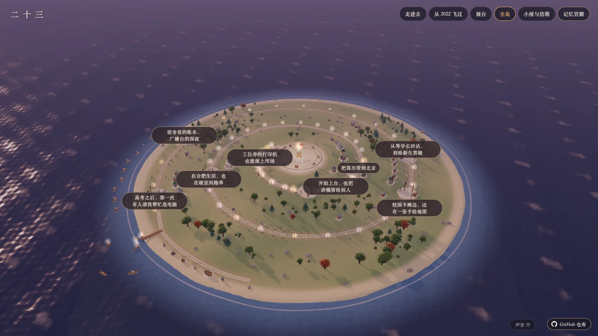
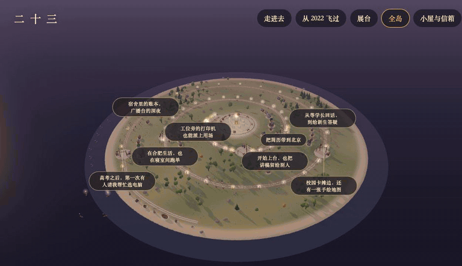
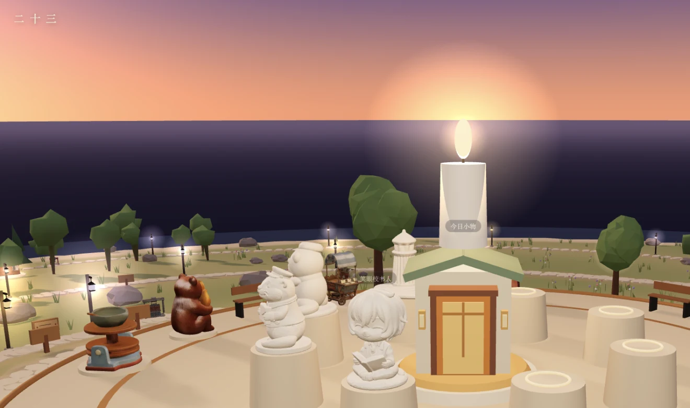
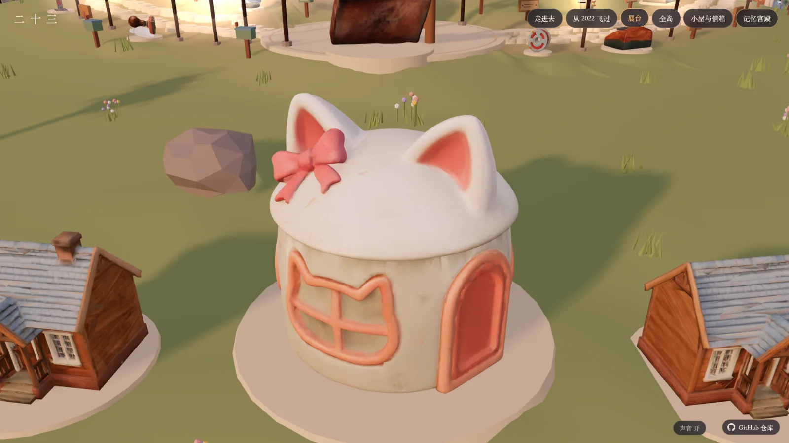
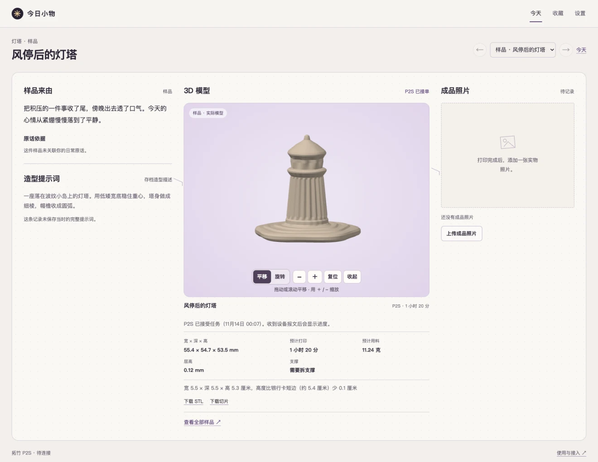
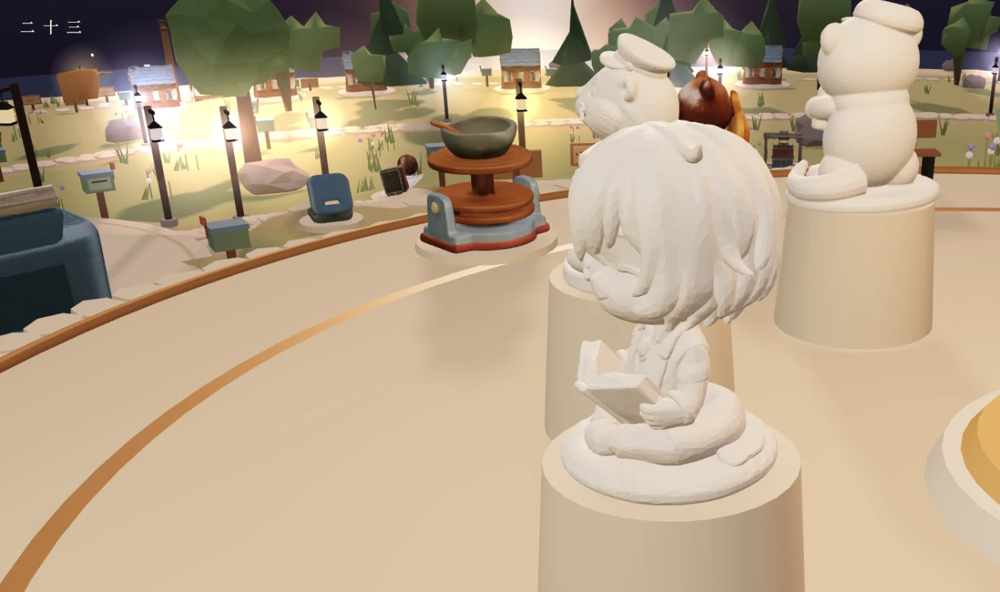
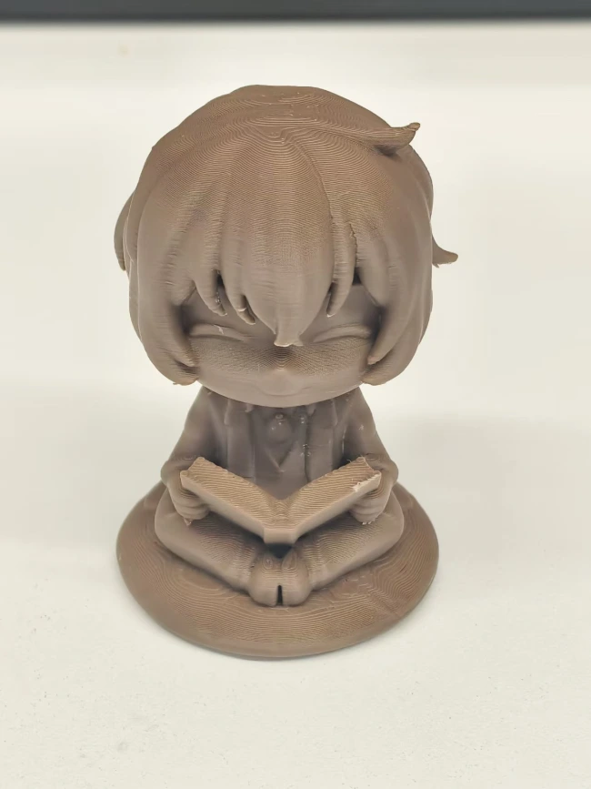
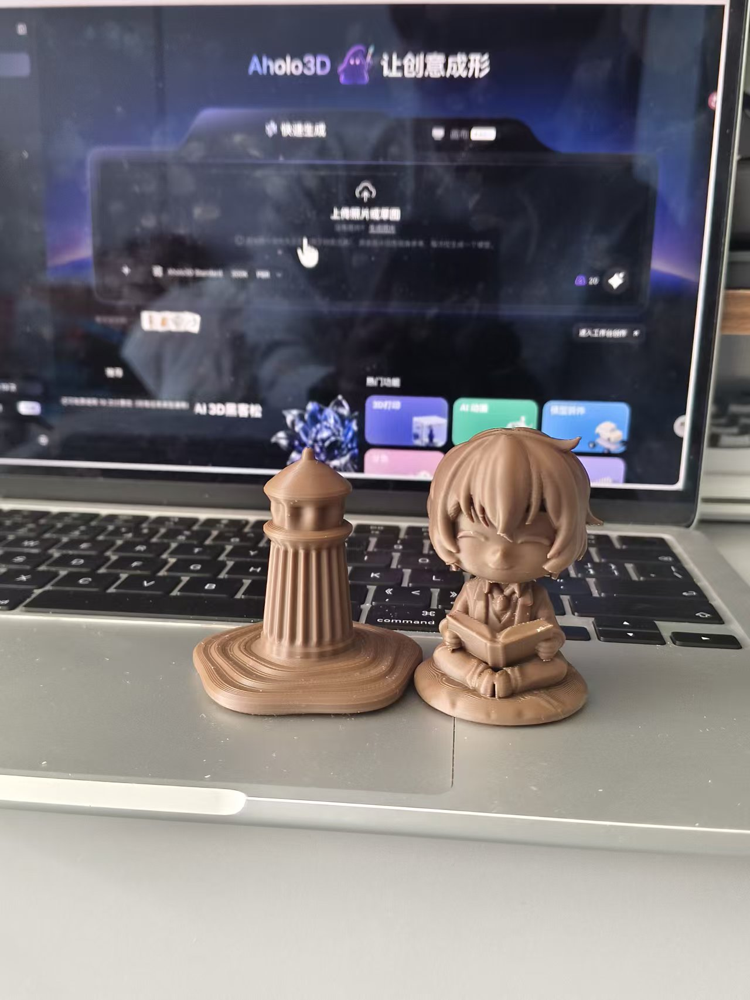
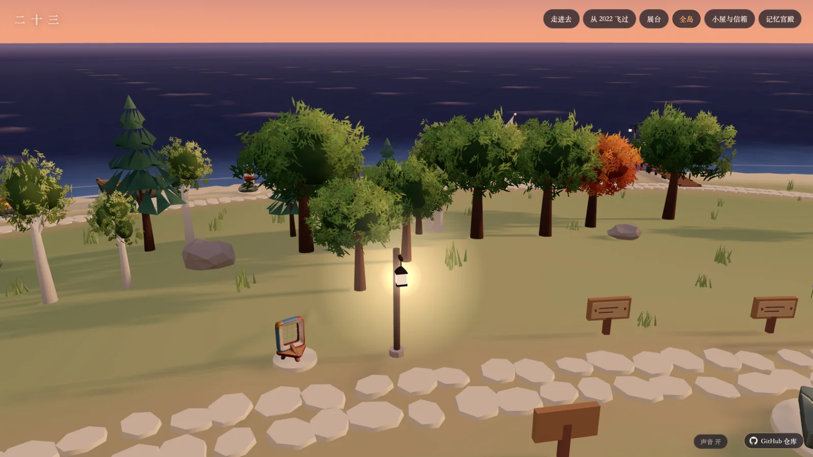

# 今日小物：把每一天打印出来，摆进我的人生小岛

**[打开线上小岛](https://life3d.agichuang.com/)** · [直达「笑眼校书人」](https://life3d.agichuang.com/#object=ex-c42025bc6efa2ad96614) · [本机安装与运行](#本机运行)

线上小岛是公开的只读演示。用浏览器就能逛小岛、看 3D 展品和实物照片，无需安装。

[](https://life3d.agichuang.com/)

**今天发生过的一件小事，能不能做成一件拿在手里的东西？**

我从当天的待办和与 Agent 的对话里，挑一个值得留下的瞬间。比如从一堆相似的记录里找回一句话，就做一个坐在地上翻书的小人。等它从打印机里出来，再把模型和实物照片摆进「二十三」的展台。岛上的小路还留着从 2022 年走到现在的故事，和一路上遇见的人。

| Aholo 实际消耗 | 本机整理的微信记录 | 其中，与他人的双向私聊 |
| :--- | :--- | :--- |
| **4,104 积分** | **5,483,696 条** | **1,275,475 条** |

## 先上岛看看



- **走进去** 用 `WASD` 走，拖动或移动鼠标转头，靠近物件后按 `E` 打开卡片。
- **从 2022 飞过** 沿时间路飞行。点亮灯的小路、阶段门和路边的摆件，都是故事的入口。
- **展台** 看每天做成的小物。点开模型，可读那天的来由，也能看已归档的实物照片。
- **小屋与信箱** 从目录里查找人物。点「去看小屋」或「去看信箱」，镜头会带你到岛上的位置。

| 展台 · 今天做出来的小物 | 小屋 · 给熟悉的人留个位置 |
| :--- | :--- |
|  |  |

## 一件小物怎么做出来

1. **挑一天里的一个瞬间。** 工作台按三端汇集指定日期的记录：我亲手打给 AI 的话、Agent 自己跑完的工作和提醒、手写的待办。按项目归组后提炼成一段经历，再想一件可以放在桌上的东西。画布上能看到三端各有多少条、摘要依据的是哪几句原话。记录和造型理由留在本机。
2. **把念头变成模型。** 发给 Aholo 的是造型描述。从参考图到 G1 模型，可以先看效果，再决定要不要换造型。旧版还留着，积分按实际任务回执累计。
3. **切片，再决定尺寸。** Blender 检查模型，Bambu Studio 用匹配打印机、喷嘴和耗材的设置切片。工作台显示实际切片的尺寸、用料和预计耗时，并按三小时的打印上限选择尺寸。
4. **确认开打，带回岛上。** 开打前由本人确认清盘、料位颜色和飞书确认码。生成的模型可以先入展，打出来后再给同一件小物补一张实物照片。



### 笑眼校书人

那天我在核对旧记录，有的段落看起来几乎一样，回到原始编号才知道该怎么处理。我把这个动作放进摆件里。一双手按住摊开的书，眼睛弯起来，头略微低下。左边是小岛上可以转着看的展品，右边是打出来的那一件。

<table>
  <tr>
    <th>岛上的展品</th>
    <th>打印后的实物</th>
  </tr>
  <tr>
    <td><a href="https://life3d.agichuang.com/#object=ex-c42025bc6efa2ad96614"></a></td>
    <td></td>
  </tr>
</table>

#### 实测打印合照

<p align="center"></p>

右边的「笑眼校书人」由 Aholo 生成 3D 模型，经检查和切片后实测打印。左边是工作台的离线灯塔样品，也完成了试打。

## 二十三，怎么把经历做成一座岛

时间从岸边往里走。**8 个阶段、54 盏月灯、74 段路边往事**，让几年的经历有了可以回去的地方。月灯用暖琥珀与冷蓝表现不同的情绪。球场、麦克风和书桌把当时的场景做成可以靠近看的物件。

岛上有 **133 张人物卡、9 款住宅造型和 56 件场景摆件**。小屋和信箱有各自的位置。岛心的展台收录了 **4 件每日作品模型**，其中一件可查看打印后的实物照片。公开快照中的人物用化名，展览只提供浏览。



## 算力与记录

**4,104 个 Aholo 积分**来自 262 个唯一任务的实际扣款回执，其中小岛场景与住宅用掉 **3,956 分**，每日小物及试作用掉 **148 分**。用在概念参考图上的有 **1,584 分**，用于 G1 建模的有 **2,520 分**。同一个任务被沿用时只计一次。统计截至 2026 年 11 月 19 日。

**5,483,696 条微信记录**完成本机入库和统计，覆盖 2019 年 6 月至 2026 年 11 月，包含私聊、群聊和系统记录。其中 **1,275,475 条**是我与他人的双向私聊消息，口径排除了系统事件、已识别的工具会话和发给自己的消息。小岛从整理后的材料中抽取能够做成场景和卡片的片段。

## 本机运行

以下步骤供下载源码后在自己的电脑上运行。`127.0.0.1` 始终指向当前电脑。先启动对应服务并保持终端运行，再把地址复制到同一台电脑的浏览器。

| 路径 | 用途 |
| :--- | :--- |
| [`二十三/`](二十三/) | Three.js 小岛、脱敏快照与展示模型 |
| [`今日小物/`](今日小物/) | 本机工作台，负责记录、生成、切片、打印与照片归档 |
| [`build-site.mjs`](build-site.mjs) | 从演示快照生成只读网站 |

### 本机预览只读小岛

需要 Node.js 和 Python 3。在仓库根目录执行下面的命令。

```sh
node build-site.mjs
python3 -m http.server 5233 --bind 127.0.0.1 --directory public
```

启动后访问 `http://127.0.0.1:5233/`，查看用当前源码构建的只读演示。

### 运行打印工作台

需要 macOS 和 Python 3.11+。在仓库根目录执行下面的命令。

```sh
cd 今日小物
python3 -m venv .venv
.venv/bin/pip install -r requirements.txt
MOODPRINT_DATA="$PWD/demo-data" .venv/bin/python -B app.py --port 17868
```

启动后访问 `http://127.0.0.1:17868/`。点工作台页脚的「使用与接入」，查看模型生成、切片和打印的配置步骤。

### 在本机小岛里打开工作台

保持工作台运行，在另一个终端从仓库根目录启动小岛。

```sh
cd 二十三
PORT=5232 WORKBENCH_PORT=17868 python3 -I serve.py
```

启动后访问 `http://127.0.0.1:5232/`，点小岛上的「今日小物」。

### 离线测试

```sh
cd 今日小物
.venv/bin/python -B -m unittest discover -s tests
```

## 一起做这个项目的 AI

- **GPT（Codex）**：搭起了今日小物工作台的大部分流程，包括 Aholo 生成、切片、打印机和飞书确认，也跑完了生日礼物几百万条记录的整理和世界数据。
- **Claude**：负责规划和整合，做了记忆宫殿、会动的海、声音和动效，以及三端读取的经历摘要。

## 特别鸣谢

<p align="center"><a href="https://www.aholo.cn/"></a></p>
<p align="center">感谢群核科技提供的 3D 算力支持。</p>
